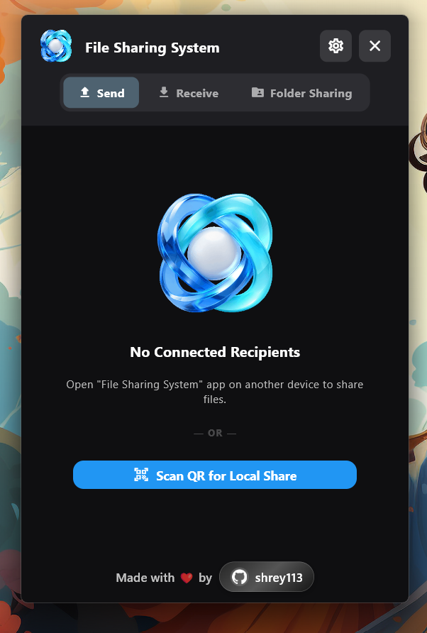

# File Sharing System

  

<h2 align="center">File Sharing System</h2>

  <strong>High-Speed Peer-to-Peer File Transfer</strong>

  Secure · Direct · Cloudless

  A unified file transfer and device communication platform, built for seamless data exchange across your local network.

  
  
  
  
  

---
## Overview

**File Sharing System** is a cross-platform peer-to-peer communication and file transfer platform designed for high-speed data exchange across devices connected to the same local network.

The system enables users to transfer files, synchronize clipboard content, and exchange text and hyperlinks without depending on cloud storage services, external infrastructure, or internet-based transfer relays.

Built around direct network communication, the platform takes advantage of available LAN and wireless connectivity to deliver efficient data transmission while keeping communication within the local network environment.

Its architecture combines automatic device discovery, optimized socket-based communication, selective transfer approval, and browser-based access into a unified file-sharing experience.

## APP preview

|  |  |
|:---:|:---:|
| **Desktop interface** | **Mobile interface** |

|  |  |
|:---:|:---:|
| **Media Center** | **Android Control** |

|  |  |
|:---:|:---:|
| **Audio Overlay** | **Media Preferences** |

## Core Capabilities

### High-Speed File Transfer
Fast and reliable file sharing between connected devices with efficient transfer processing and support for large files.

### Automatic Device Discovery
Automatically discovers nearby compatible devices and establishes seamless connectivity without manual configuration.

### Selective Transfer Approval
Maintains recipient control through individual file previews, allowing users to accept or reject incoming transfers.

### Clipboard and Content Sharing
Instantly exchange text, clipboard content, and hyperlinks between connected devices.

### Browser-Based Sharing
Share files with devices through a responsive web interface without requiring additional application installation.

### Intelligent Network Management
Automatically identifies suitable network connections and optimizes device communication for reliable transfers.

### Background Operation
Keeps device communication and ongoing transfers active while minimizing interruptions to normal application usage.
## Supported Platforms

The application provides platform-specific distributions for the following operating systems.

| Platform | Architecture | Distribution |
|---|---|---|
| Windows | x86_64 | Portable `.exe` / ZIP |
| Android | ARM64-v8a, armeabi-v7a, x86_64 | `.apk` |
| macOS | Apple Silicon / Intel | `.app` / ZIP |
| Linux | x86_64 | Standalone binary / `.tar.gz` |
| Web | Modern browsers | Embedded HTTP interface |

## Installation and Usage

### Desktop Installation

Supported operating systems: Windows, macOS, and Linux.

1. Download the appropriate release package.
2. Extract the archive if required.
3. Launch the application executable.
4. Ensure the application is permitted to communicate through the system firewall.
5. Connect the device to the same local network as the receiving device.
6. Allow automatic discovery to identify available peers.

### Android Installation

1. Download the Android APK from the releases section.
2. Install the application on your device.
3. Grant the requested permissions.
4. Connect to the same local network as the other participating devices.
5. Open the application and allow device discovery to complete.

### Browser-Based Access

The browser client enables file sharing without installing the native application on the receiving device.

1. Start the File Sharing System application on the host device.
2. Ensure the embedded HTTP server is running.
3. Obtain the host device's local IP address.
4. Open a browser on another device connected to the same network.
5. Navigate to the following address:

   `http://<HOST_IP>:9876`

6. Use the web interface to exchange supported files and content.

Alternatively, scan the QR code displayed by the host application when available.

---

## Network Architecture

The platform is designed around direct local communication rather than cloud-mediated file transfer.

### Communication Model

- **Discovery:** mDNS/DNS-SD-based local peer discovery.
- **Transport:** Direct TCP/UDP communication where supported by the relevant service.
- **Web Access:** Embedded HTTP server.
- **Device Connectivity:** Local area network and direct wireless connectivity.
- **Transfer Management:** Recipient-controlled incoming transfer approval.

### Network Requirements

For reliable operation:

- Participating devices should be reachable over the same local network or an appropriately configured wireless access point.
- Firewall rules must permit the application's required communication ports.
- Network isolation and client isolation features should be disabled where they prevent peer-to-peer communication.
- Available bandwidth and network hardware determine achievable transfer performance.

---

## Security and Privacy

Privacy and local network communication are central design considerations.

### Local Network Communication

File transfers are designed to operate directly between participating devices without requiring an external cloud transfer service.

### Network Interface Selection

Communication interfaces are selected to avoid unintended routing through unsupported virtual or tunneling adapters.

### Recipient Authorization

Incoming file requests are presented for recipient verification before accepted files are written to local storage.

### Reduced External Dependencies

The core transfer architecture does not depend on remote file-hosting infrastructure or external transfer relays.

---

## Project Distribution

Official application builds and platform-specific releases are distributed through the project's release channel.

**Release packages:** Windows, Android, macOS and Linux.

**Web client:** Provided through the embedded HTTP service.

For installation instructions, compatibility information, and release updates, refer to the project's official distribution channel.

---

## License and Usage Restrictions

**Copyright © 2026. All Rights Reserved.**

File Sharing System and its associated software distributions are proprietary and confidential.

### Permitted Use

Users are permitted to download, install, and execute officially distributed precompiled application packages for personal or internal organizational use, subject to the terms of this agreement.

### Restrictions

Without prior written authorization from the copyright holder, users may not:

1. **Source Code Extraction:** Access, extract, or attempt to obtain the proprietary source code.
2. **Reverse Engineering:** Decompile, disassemble, decrypt, or reverse engineer the software or its underlying implementation.
3. **Modification:** Modify, patch, adapt, or create derivative works from the software.
4. **Redistribution:** Redistribute, sublicense, lease, rent, or commercially resell the software or its distributions.
5. **Unauthorized Commercial Use:** Offer the software as a paid hosted service or otherwise commercially exploit its functionality without authorization.

### Disclaimer of Warranty

THE SOFTWARE IS PROVIDED "AS IS", WITHOUT WARRANTY OF ANY KIND, EXPRESS OR IMPLIED, INCLUDING BUT NOT LIMITED TO WARRANTIES OF MERCHANTABILITY, FITNESS FOR A PARTICULAR PURPOSE, AND NONINFRINGEMENT.

IN NO EVENT SHALL THE COPYRIGHT HOLDER BE LIABLE FOR ANY CLAIM, DAMAGES, OR OTHER LIABILITY ARISING FROM THE SOFTWARE, ITS DISTRIBUTION, OR ITS USE.

---

  <strong>File Sharing System</strong>
   
  Direct Device Communication. Without Cloud Dependency.
    
  © 2026 All Rights Reserved.

